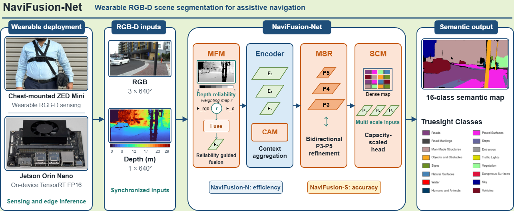

# NaviFusion-Net: Efficient RGB-D Sensor Fusion for Scene Segmentation in Assistive Navigation

By M. A. Imtiaz, S. L. Phung, Y. Di, H. T. Le, H. Siddique, L. Bui, and A. Bouzerdoum.



The paper is under review, and the code will be released after publication.

## Highlights

- Depth-guided early fusion with MFM (DRAFStem / DGAFRStem)
- Lightweight multi-scale refinement (MSR) at P3/P4
- Context aggregation (CAM) at P5
- Two operating points: **NaviFusion-N** (efficiency) and **NaviFusion-S** (accuracy)
- TrueSight RGB-D evaluation and Jetson Orin Nano TensorRT deployment

## Results on TrueSight (RGB-D)

| Model | mIoU (%) | FPS (RTX 4090) | Params (M) |
|:------|--------:|---------------:|-----------:|
| YOLOv10-N (RGB-D) | 52.98 | 127.76 | 2.52 |
| **NaviFusion-N** | **54.98** | 107.33 | 3.59 |
| YOLOv10-S (RGB-D) | 55.88 | 118.11 | 7.88 |
| **NaviFusion-S** | **57.20** | 75.75 | 10.39 |

## Qualitative Examples


## Embedded Deployment


NaviFusion-N / NaviFusion-S support TensorRT FP16 inference on Jetson Orin Nano with live ZED Mini RGB-D input.

## Code

Training, evaluation, and deployment code will be released here after the paper is published.

## Citation

```bibtex
@article{imtiaz2026navifusion,
  title={NaviFusion-Net: Efficient RGB-D Sensor Fusion for Scene Segmentation in Assistive Navigation},
  author={Imtiaz, Muhammad Atif and Phung, Son Lam and Di, Yang and Le, Hoang Thanh and Siddique, Hira and Bui, Ly and Bouzerdoum, Abdesselam},
  journal={IEEE Sensors Journal},
  year={2026},
  note={Under review}
}
